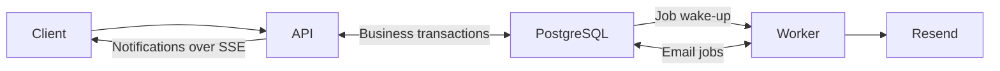

# Architecture

SiteTrack is a modular monolith: one API process and one worker share PostgreSQL.
Domains own their business rules and SQL. Shared infrastructure provides database
access, email delivery, rate limiting, telemetry and outbox processing.

The [assessment answer](<SeronLabs Assessment.docx>) contains the detailed design.
[API.md](API.md) lists endpoints; `/docs` serves the interactive API reference.

## Domain boundaries

| Domain | Owns |
| --- | --- |
| Authentication | Accounts, app roles, verification, password reset and sessions |
| Projects | Projects, memberships, project admins and invitations |
| Tasks | Project tasks, dependency graphs and status changes |
| Materials | Shared catalogue, categories and units |
| Stores | Company and project quantities, reorder points and stock status |
| Deliveries | Material movement between company and project stores |
| Notifications | User notifications, unread counts and SSE replay |

A project contains members, tasks and a logical store. Materials belong to the
shared catalogue; their quantities belong to stores. Each delivery belongs to a
project and records its direction and material quantities.

Project and task codes are their primary keys. Other standalone entities use
UUID v7. Memberships, dependencies, store entries and delivery items use composite keys.

## Access and task management

App roles control application-wide access. Membership controls project access;
project admin membership controls management. SuperAdmins can view every project,
but managing a project's tasks or store still requires project admin membership.
Creating a project makes its creator an admin. Invitations target registered users
and expire after seven days.

Authlier handles authentication with one active session per account. Requests verify
the JWT and check the database for the current session, role and membership.

Task dependencies form an acyclic graph and retain waiting/satisfied state. Starting
requires completed dependencies. Completion and reopening update dependency state
atomically; reopening is blocked while a dependent task has started. Project row
locks serialize graph edits, task transitions and membership changes.

## Stock movement

Supplier stock enters the company store. Deliveries move it to project stores and
back. Sending deducts the source quantity; receiving credits the destination.
Rejecting or cancelling returns stock to the source. Transit quantities reserve
capacity for those returns.

Stock and delivery changes share a transaction. Ordered project, delivery and
material locks prevent overspending and duplicate completion. Exact decimal
quantities and database constraints protect balances. Removed catalogue records
retain stock and delivery history.

## Notifications and email

Business transactions create notification rows alongside their changes. After
commit, the API delivers them through SSE. Stored revisions support replay with
current access checks. Project activity goes to the team, excluding the actor.

Verification and password-reset emails use the transactional outbox. LISTEN/NOTIFY
wakes the worker, with polling as a fallback. The worker processes bounded batches
using leases, stable idempotency keys and retries. It decrypts queued email payloads
and sends them through Resend.

## API contracts and verification

Request contracts come from runtime DTOs and validation rules; response contracts
are defined manually. OpenAPI and Scalar expose both. Lists use cursor pagination.
Endpoint policies apply rate limits, and OpenTelemetry exports operational telemetry.

[SEED.md](SEED.md) covers the assessment dataset.
[LOAD_TESTING.md](LOAD_TESTING.md) contains verification commands and results.
